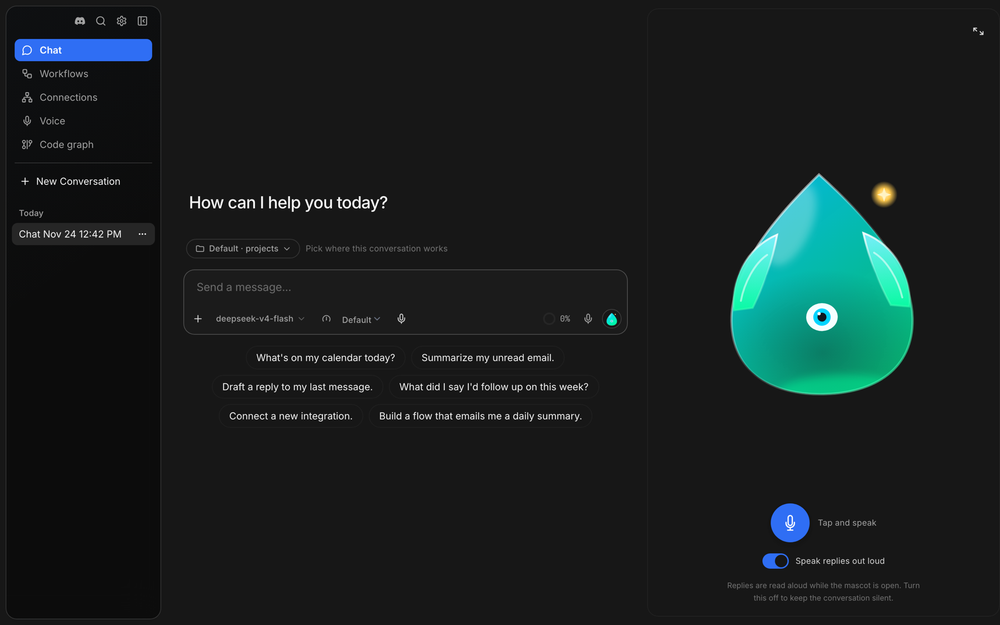
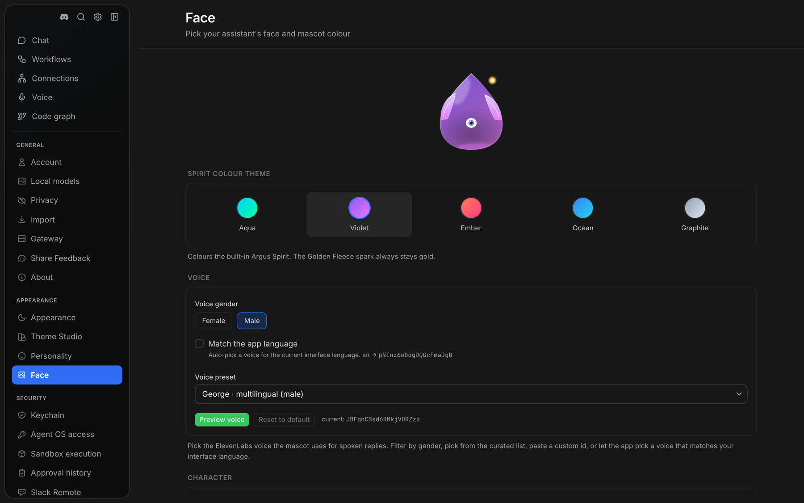
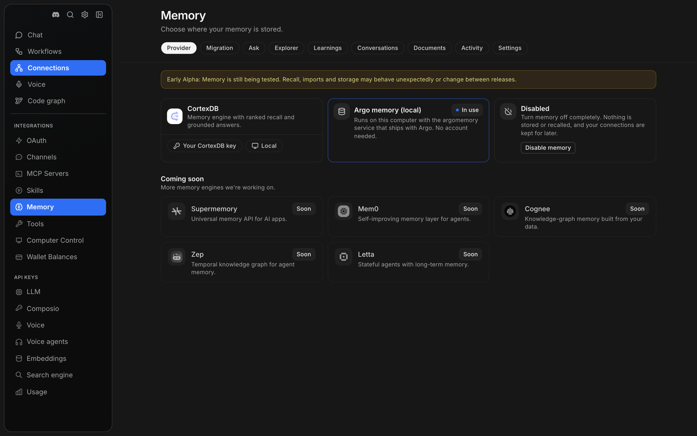

# Argo

Argo is a desktop AI workspace for macOS that keeps your work and your memory on your own computer. Chat with the model you choose, let it search the web, speak to it, and have it remember what matters, without an account.

## What you get

- **Your models, your keys.** Point Argo at a local model server or add an API key for a provider you already use. First launch walks you through it in three steps.
- **Memory on your machine.** Argo ships with its own local memory service, so recall works with no sign-in. It is chosen by default and can be switched or turned off under Connections → Memory.
- **Web search built in.** A bundled search service runs locally.
- **Voice.** Push-to-talk from the chat box or the Voice page.
- **Workbench and code graph.** Run sessions against a git repository, each in its own worktree, and browse the structure of a codebase.
- **Updates in the app.** Argo checks this page for new signed builds.

| Make it yours | Memory |
| --- | --- |
|  |  |

## Install

Requires a Mac with Apple Silicon.

1. Download `Argo_<version>_aarch64.dmg` from the [latest release](../../releases/latest).
2. Open it and drag Argo to Applications. A `.pkg` installer is attached too.
3. These builds are not notarized by Apple. The first time, open Argo from Applications with a right-click and choose Open, or allow it under System Settings → Privacy & Security.
4. macOS will ask for access to your Keychain, which Argo uses to protect its secrets. Choose Always Allow.

## Updates

Argo checks for a new version on its own. Each release carries a signed update archive (`Argo.app.tar.gz`) and `latest.json`; the app only installs an update whose signature matches the key built into it.

## Licence and source

Argo is free software under the GNU General Public License v3. The complete corresponding source code of every release, including all bundled components, is attached to that release as `Argo-source-<version>.tar.gz`. Credits and third-party notices are in `ARGO-NOTICE.md` inside the app bundle. Argo is a fork of another open-source project and is not an official product of its authors.
